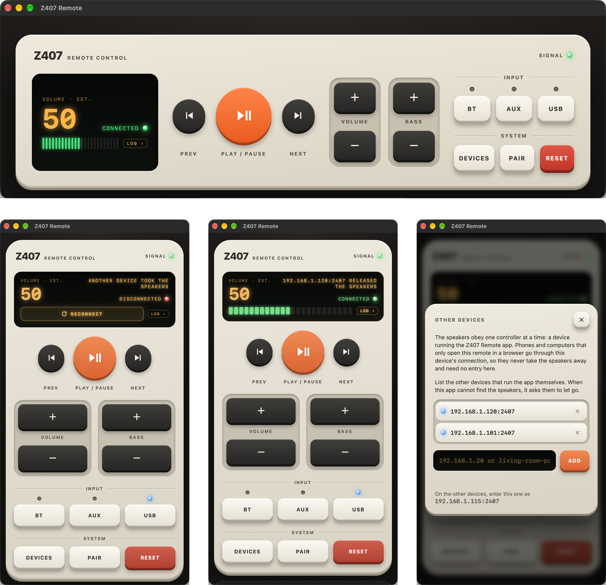
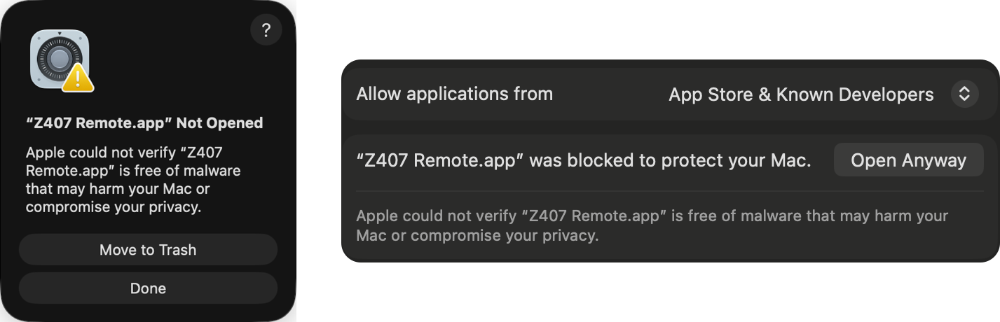

# Z407 Remote Anywhere

A remote control for the **Logitech Z407** Bluetooth speakers that runs on your computers and phones at once. Each device talks to the speakers over Bluetooth LE; the speakers accept only one at a time, so the device you pick up takes them over and the others step aside. Every copy also serves the remote to the rest of your network, so any browser can use it.

<p align="center"></p>

## Features

- Volume, bass, play/pause, track skip, input (Bluetooth, AUX, USB), pairing and factory reset
- Windows, macOS and Linux (one self-contained program each) and Android
- Several devices share the speakers: the one you use takes them, the others show "Disconnected" and a Reconnect key
- Opens in a window of its own; phones and tablets on the network can open the same remote and add it to their home screen
- A log viewer on the remote itself, and an [HTTP API](#http-api) for scripts and home automation

## Install

Download the file for your platform from the [releases page](https://github.com/mp3cko/z407-remote-anywhere/releases).

| Platform | File | Start |
| --- | --- | --- |
| Windows 10/11 | `z407_…_windows_amd64.zip` | `z407.exe` |
| macOS | `z407_…_darwin_arm64.tar.gz` (Apple silicon) or `…_amd64.tar.gz` (Intel) | `Z407 Remote.app`, see below |
| Linux | `z407_…_linux_amd64.tar.gz` or `…_arm64.tar.gz` | `./z407`; `./z407 --install` adds it to the applications menu |
| Android 8.0+ | `z407_…_android.apk` | open it on the phone and allow installing from that source |
| iPhone, iPad | nothing to download | add the remote to the home screen, see [iOS](#ios) |

### macOS: the first start

The app is not notarized by Apple, so macOS blocks it the first time ("Apple could not verify…"). Once:

1. Move `Z407 Remote.app` to Applications and open it. macOS says it was not opened: press **Done**.
2. Open **System Settings > Privacy & Security**, scroll down to "Z407 Remote.app was blocked…" and press **Open Anyway**, then confirm.
3. Allow Bluetooth when asked, so the app can reach the speakers.

<p align="center"></p>

Or in a terminal: `xattr -dr com.apple.quarantine "/Applications/Z407 Remote.app"`. After that the app opens like any other.

### Linux: not tested on real hardware

The Linux build has only been run under WSL, where Bluetooth does not work. The Bluetooth side on Linux (through BlueZ) is therefore untested; reports are welcome.

## Using it

Start the app. The remote opens in its own window, and closing the window stops the app.

The display tells what is going on ("Searching…", "Connected", "Speakers not found", "Asking living-room-pc to release the speakers"); press it to see the log. Below the remote, "Web address" shows where other devices on your network can open it, for example `http://192.168.1.50:2407`. On a phone, choose "Add to Home screen" in the browser menu to get an icon for it. That page works while the app runs.

### Several devices

To let the device you are using take the speakers from another one, each needs to know where the others are:

1. Press **Devices** on the remote.
2. Enter each other device as `host` or `host:port` (for example `living-room-pc` or `192.168.1.20`; the port defaults to 2407) and press **Add**. The foot of the panel shows what to enter for the device you are looking at.
3. Do the same on the other devices.

From then on a device that starts, or whose Reconnect key is pressed, asks all the others at once to let go of the speakers while it looks for them itself; a device added to the list later is asked once the speakers have not shown up for 3 seconds. The one that lets go shows "Disconnected" and a **Reconnect** key, which takes the speakers back. Devices only take the speakers from each other when one is started or Reconnect is pressed, so two of them never fight over the speakers. A device that is still looking for the speakers itself does not let go when asked, so two devices started at the same moment do not both end up disconnected. Devices that are off are skipped.

The list is saved in `z407/config.json` in your configuration directory (`%AppData%`, `~/Library/Application Support`, `~/.config`).

### Command-line options

| Option | Default | |
| --- | --- | --- |
| `--port 2408` | 2407 | port to serve the remote on |
| `--ip 127.0.0.1` | all interfaces | address to serve the remote on |
| `--no-window` | | open no window, run until Ctrl+C (for a machine without a screen) |
| `--log file` | terminal | write the output to the log file instead (see below) |
| `--peers pc,192.168.1.20` | saved list | other devices for this run only |
| `--install`, `--uninstall` | | Linux: add or remove the applications-menu entry |

### Without a window

For a terminal, a server in a cupboard or a machine without a screen, run only the server:

```bash
./z407 --no-window                                               # Linux
"/Applications/Z407 Remote.app/Contents/MacOS/z407" --no-window  # macOS
z407_console.exe --no-window                                     # Windows
```

The log goes to the terminal, and the remote is at the address the app prints (`http://<this computer>:2407`). Ctrl+C stops it. On Linux without a graphical session (over SSH, on a server) the app opens no window anyway.

## Platform notes

**The window.** On macOS the remote opens in a window of the app itself. On Windows and Linux it is an "app" window of a Chromium-based browser (Edge, Chrome, Chromium, Brave, Vivaldi, Opera or Yandex) with a profile of its own, so your normal browser is not touched. Without one of those it opens as a tab in the default browser, and the app stops a few seconds after the last tab on that computer is closed.

**The log** is shown on the remote (press the display). Started without a terminal the app also writes it to `%LOCALAPPDATA%\z407\z407.log` (Windows), `~/Library/Caches/z407/z407.log` (macOS) or `~/.cache/z407/z407.log` (Linux), and a startup problem is shown in a dialog.

**Windows.** `z407.exe` opens no console window. `z407_console.exe` is the same app for a terminal: it logs there and stops with Ctrl+C.

**macOS.** The program itself is inside the app, for use in a terminal: `"Z407 Remote.app/Contents/MacOS/z407" --help`.

**Android.** The app connects to the speakers itself; no computer is needed.
- It asks for "Nearby devices" (Android 12+) or Location (Android 8 to 11, where Bluetooth scans need it). It does not use your position.
- It keeps working in the background, with a notification that shows the connection and has volume and play/pause keys. To stop it, press Quit in the expanded notification or swipe the app away.
- While it runs it serves the remote on port 2407 like the desktop app. To share the speakers with a computer, add each to the other's Devices list. The phone's address can change when it rejoins the network unless the router reserves it.

### iOS

There is no iOS app, and none can be built from this repository: getting an app onto iPhones takes the App Store and a paid Apple developer account. An iPhone or iPad can still use the remote, through a computer or an Android phone that runs the app on the same network:

1. Open the remote's web address (shown under "Web address", for example `http://192.168.1.50:2407`) in Safari.
2. Press **Share**, then **Add to Home Screen**.

The icon opens the remote like an app. The iPhone does not talk to the speakers itself: the device it points to does, and has to be running.

## HTTP API

Every copy of the app, Android included, answers the same HTTP API the remote's page uses, on the same port (2407 by default). Scripts, home automation and shortcuts can use it to control the speakers:

```bash
curl -X POST http://192.168.1.50:2407/api/vol_up      # volume up
curl -X POST http://192.168.1.50:2407/api/play_pause  # play or pause
curl http://192.168.1.50:2407/api/status              # {"connected":true,"note":"","phase":"connected","problem":"","volume":55}
```

The commands are `vol_up`, `vol_down`, `bass_up`, `bass_down`, `play_pause`, `next_speaker`, `prev_speaker`, `input_bluetooth`, `input_aux`, `input_usb`, `bluetooth_pair` and `factory_reset`. While the app is not connected to the speakers they answer 404. Other endpoints read the log, edit the Devices list and hand the speakers between devices.

The full description, with every endpoint, answer and error, is the OpenAPI spec [docs/openapi.yaml](docs/openapi.yaml); open it in an OpenAPI viewer such as [Swagger Editor](https://editor.swagger.io) to try the calls.

## Security

The remote and its API have no authentication. Anyone on your network can control the speakers, read the log and make a device let go of the speakers. Run it on networks you trust.

## Troubleshooting

- **The speakers are not found:** the Logitech Z407 takes one Bluetooth LE controller at a time. Disconnect any phone or other device that is connected to them, and see [Several devices](#several-devices).
- **macOS: nothing happens on start:** see [the first start](#macos-the-first-start). If the port is taken, a dialog says so; start the app with `--port`.
- **A phone cannot open the page:** check the computer's firewall; with a VPN, allow LAN access.
- **The window does not open:** check the log; `http://127.0.0.1:2407` works in any browser.
- **Windows, `z407_console.exe`:** clicking into the terminal can pause the program; press Enter.
- **Connecting keeps failing:** power-cycle the speakers, toggle Bluetooth, unpair and pair them again, restart the computer.

## Building

Go 1.26.1 or newer:

```bash
make build          # dist/z407 for this computer
make macos-app      # on a Mac: dist/Z407 Remote.app
make cross          # Linux and Windows from any OS, plus macOS on a Mac
make test
```

macOS builds need a Mac with the Xcode command line tools, because the Bluetooth backend and the window use cgo. `make help` lists all targets.

Android needs JDK 17 and the Android SDK (platform 35, build-tools 35.0.0), found through `ANDROID_HOME` or `sdk.dir` in `android/local.properties`. `make android` runs the unit tests and builds `dist/z407_android_debug.apk` and `dist/z407_android.apk`. The app takes the remote's page from `internal/server/index.html`. The release APK is signed with the key named by `Z407_KEYSTORE_FILE`, `Z407_KEYSTORE_PASSWORD`, `Z407_KEY_ALIAS` and `Z407_KEY_PASSWORD` (the debug key without them); the release workflow reads it from the `ANDROID_KEYSTORE_BASE64`, `ANDROID_KEYSTORE_PASSWORD`, `ANDROID_KEY_ALIAS` and `ANDROID_KEY_PASSWORD` secrets. The Bluetooth side is checked by hand: see [android/TESTING.md](android/TESTING.md).

## Acknowledgements

- The speaker protocol comes from [freundTech's reverse engineering work](https://github.com/freundTech/logi-z407-reverse-engineering).
- This project began as a Go rewrite of [Androrama's Z407 remote web app](https://github.com/androrama/Logitech-Z407-Remote-Control-Web-App---Windows).

## Disclaimer

An unofficial project, not affiliated with or endorsed by Logitech. Logitech and Z407 are trademarks of Logitech. Use it at your own risk.

## License

[MIT](LICENSE)
