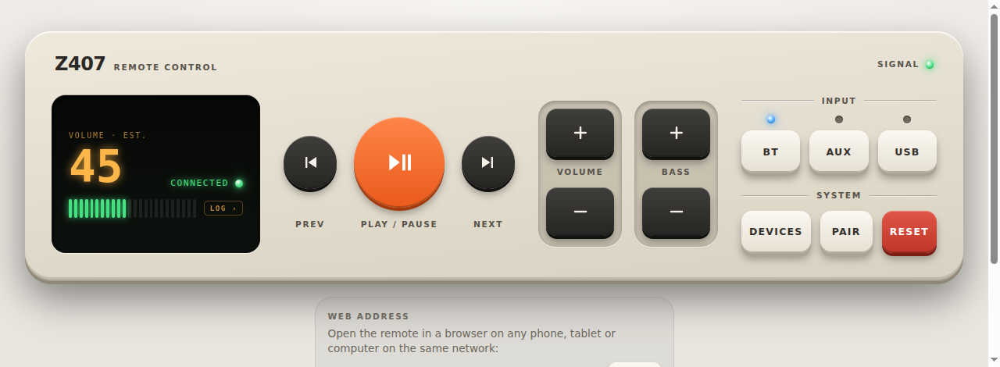
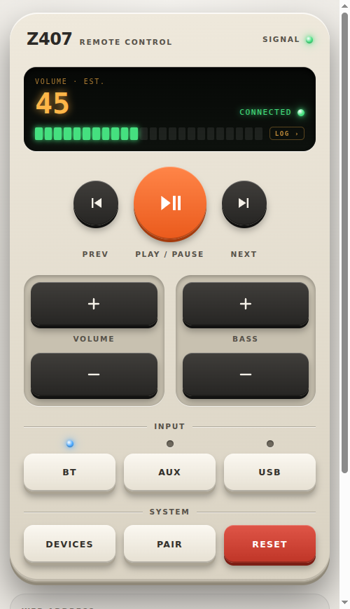
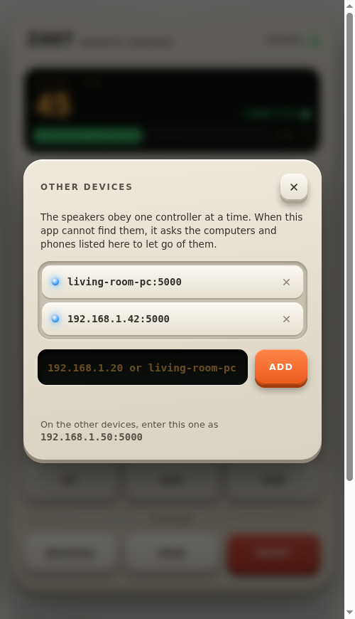
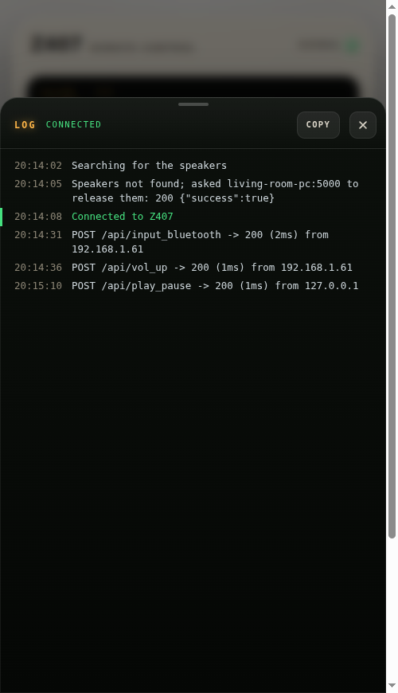
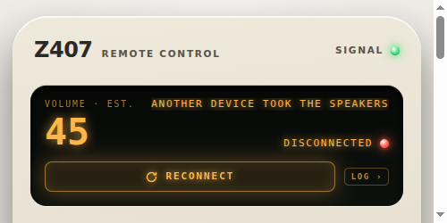

# Z407 Remote

A small remote for the Logitech Z407 speakers. It runs on a computer with Bluetooth, talks to the speakers over Bluetooth Low Energy, shows the remote in its own window, and serves the same page to any phone or tablet on the same network. There is also an [Android app](#android-app) that controls the speakers directly, without a computer.



<p align="center"> </p>

## Features

- Speaker volume, bass, play/pause and track skip
- Input selection (Bluetooth, AUX, USB), pairing and factory reset
- Opens as an app window on the computer; phones on the network can add it to their home screen
- Several computers and phones can share the speakers: the one you use takes them over, the others show "Disconnected" and a Reconnect key
- Single static binary for Windows, Linux and macOS
- Android app with the same remote, talking to the speakers directly. It keeps working in the background, with volume and play/pause keys in its notification

## Install

Download the archive for your platform from the [releases page](https://github.com/mp3cko/z407-remote-go/releases), extract it and run `z407` (`z407.exe` on Windows; the archive also holds `z407_console.exe`, see [Windows](#windows)). On macOS the archive holds the app `Z407 Remote.app`, see [macOS](#macos); on Linux `z407 --install` adds the remote to the applications menu, see [Linux](#linux).

Or build it yourself (Go 1.26.1 or newer):

```bash
make build          # dist/z407 for the current OS
make cross          # Linux (amd64, arm64) and Windows from any OS, plus macOS when run on a Mac
make windows-amd64  # a single target: dist/z407_windows_amd64.exe and ..._console.exe
make test
```

`make help` lists all targets. Windows builds produce two programs: a GUI program (`-H=windowsgui`) that opens no console window and logs to a file, and a `_console.exe` that logs to the terminal it runs in. The macOS targets (`darwin-arm64`, `darwin-amd64`) only work on a Mac, because the Bluetooth backend needs cgo.

### Platform notes

- **Linux:** BlueZ is required.
- **macOS:** build natively on a Mac (cgo and the Xcode command line tools are required; it cannot be cross-compiled). Allow Bluetooth for your terminal when prompted.
- **Windows:** Windows 10 or 11 with a Bluetooth LE adapter.

## Usage

Run `z407` (double-click it, or start it from a terminal). The remote opens in its own window. Closing the window stops the app.

While the window is open, other devices on the same network can use the remote too: open the address shown below the remote under "Web address" (for example `http://192.168.1.50:5000`; the app also prints it) on your phone. The API has no authentication, so anyone on your network who knows the address can control the speakers, read the app's log, and make the app let go of the speakers (`POST /api/disconnect`, see [Several computers](#several-devices)). The whole HTTP API is described in [docs/openapi.yaml](docs/openapi.yaml) (OpenAPI 3.1), for scripts and home automation.

The display of the remote tells what the app is doing: "Searching…", "Connecting…", "Connected", and above that what is in the way ("Speakers not found", "Bluetooth is off or missing") or what is being done about it ("Asking living-room-pc:5000 to release the speakers"). Press the display to open the log: the last 500 lines, updated as they come. No terminal is needed for that, on any platform.

<p align="center"></p>

### The window

- The window is an "app" window of Edge, Chrome, Chromium or Brave, whichever is installed. It uses its own browser profile (in your cache directory, under `z407`), so it does not touch your normal browser.
- If none of these browsers is installed, the remote opens as a tab in your default browser, and the app stops a few seconds after you close the last tab showing it on that computer. Reloading the tab is fine. Tabs on other devices never keep the app running and never stop it. Browsers that discard background tabs to save memory can stop the app this way; use `--no-window` if that bothers you.
- `z407 --no-window` opens nothing and runs until you press Ctrl+C. Use this on a machine without a screen. On Linux this is also what happens when there is no graphical session.
- `z407 --log file` writes the output to a log file instead of the terminal (`~/.cache/z407/z407.log` on Linux, `~/Library/Caches/z407/z407.log` on macOS, `%LOCALAPPDATA%\z407\z407.log` on Windows); `--log terminal` is the default everywhere except in the [Windows](#windows) GUI build.
- Ctrl+C in the terminal stops the app in every mode and closes the window (except for the Windows GUI build, which is not attached to the terminal: close its window instead).

### Options

By default the app listens on all interfaces on port 5000. To change that:

```bash
z407 --ip 127.0.0.1 --port 8080
```

### Several devices

The speakers accept one Bluetooth LE controller at a time, so a second copy of this app, on another computer or on a phone, cannot connect while the first one holds the link. To let the copy you are using take them, tell each copy where the others run:

1. Press **Devices** on the remote (in the System row).
2. Enter the other device as `host` or `host:port` (for example `living-room-pc` or `192.168.1.20:5001`; the port defaults to 5000) and press **Add**. The foot of the panel shows what to enter for the device you are looking at.
3. Do the same on the other devices, so that each one lists the rest.

Every change is saved at once and takes effect at once; the cross next to an entry removes it. On a computer the list is stored in `z407/config.json` in your configuration directory (`%AppData%` on Windows, `~/.config` on Linux, `~/Library/Application Support` on macOS).

Or start the app with `--peers living-room-pc,192.168.1.20:5001`. This replaces the saved list for that run only; the saved list is not changed and cannot be edited on the remote during that run.

When a copy has looked for the speakers for 3 seconds without seeing them (free speakers show up within a second or two), it sends `POST /api/disconnect` to every device on its list. A copy that receives this lets go of the speakers and stays open: its display says "Disconnected" and "Another device took the speakers", and shows a Reconnect key. The searching copy then connects, usually within a few seconds. If the speakers were seen but the connection does not come about, the same happens after 10 seconds. Devices that are off or not running the app are skipped.

<p align="center"></p>

Press **Reconnect** to take the speakers back: the copy searches again and, like a freshly started one, asks the others to let go. A copy asks each device at most once per search, never asks itself, and asks nobody while it is disconnected, so two copies that list each other cannot keep taking the speakers from each other: they change hands only when somebody starts a copy or presses Reconnect.

Like the rest of the API, `/api/disconnect` and `/api/reconnect` are not authenticated: anyone on your network can make the app let go of the speakers or take them back.

### On your phone

Open the address in the phone's browser and choose "Add to Home screen" from the browser menu. You get an icon that opens the remote without the browser's address bar. It works while the app is running on the computer. (A full offline-capable install needs HTTPS, which a LAN address does not have; the shortcut is all that is needed here.)

### Windows

`z407.exe` is a GUI program: it opens no console window and by default prints nothing in the terminal it was started from. It writes its log to `%LOCALAPPDATA%\z407\z407.log`, and a startup problem (for example the port being in use) is shown in a message box. The address for other devices is shown below the remote, under "Web address".

`z407_console.exe` is the same app as a console program: started from a terminal (PowerShell, cmd, WSL) it logs there, the shell waits for it, and Ctrl+C stops it. Double-clicking it opens a console window next to the remote.

To see the log of `z407.exe` live, pipe its output (`.\z407.exe | Out-Host` in PowerShell, `z407.exe | cat` in WSL). `z407.exe --log terminal` also writes to the terminal it was started from, with two limits that come from being a GUI program: the shell does not wait for it, so the output appears over the next prompt, and under WSL the output is garbled (use the pipe there).

### Linux

A Linux program file cannot carry an icon, so the icon comes with a menu entry:

```bash
./z407 --install     # adds "Z407 Remote", with its icon, to the applications menu
./z407 --uninstall   # removes it again
```

The entry and the icon are written to `~/.local/share` (no root needed) and start the program from where it is now; run `--install` again after moving it. Started from the menu the app logs to `~/.cache/z407/z407.log`.

### macOS

The release archive holds `Z407 Remote.app`: move it to Applications and open it. The app is not notarized by Apple, so the first time right-click it and choose Open (or allow it under System Settings > Privacy & Security), and allow Bluetooth when asked. It has no Dock icon; closing the remote's window quits it. It logs to `~/Library/Caches/z407/z407.log`, and a startup problem is shown in a dialog.

The program itself is inside the app, for use in a terminal: `"Z407 Remote.app/Contents/MacOS/z407" --help`. `make macos-app` builds the app on a Mac.

## Android app

The Android app shows the same remote and talks to the speakers itself over Bluetooth LE. No computer is needed. It needs Android 8.0 or newer.

Install: download `z407_vX.Y.Z_android.apk` from the [releases page](https://github.com/mp3cko/z407-remote-go/releases) on the phone and open it (Android asks you to allow installing from that source), or from a computer with the phone attached: `adb install z407_vX.Y.Z_android.apk`.

Good to know:

- On first start the app asks for the "Nearby devices" permission (Android 12 and newer) or the Location permission (Android 8 to 11, where Bluetooth scans require it and Location must be switched on). The app does not use your position.
- **It keeps working in the background.** Once opened, the app stays connected when you switch to another app or turn the screen off. A notification says so for as long as it does: it shows the state of the connection ("Connected", "Searching…", "Disconnected"), has keys for volume down, play/pause and volume up, and opens the app when tapped. Expanded, it also has a Quit key. On Android 13 and newer the app asks for permission to show it; without the permission the app still works in the background, but you do not get the keys.
- **To stop it**, expand the notification and press Quit, or swipe the app away in the list of recent apps. The notification disappears, the speakers are released for other controllers, and the phone stops serving the remote.
- **Other devices can use the phone's remote.** While the app runs it serves the remote to the network on port 5000, like the desktop app: open the address shown under "Web address" in a browser on another device. As on the computer, there is no authentication, so anyone on your network can control the speakers through it and read the app's log.
- **Sharing the speakers with a computer** works as described under [Several devices](#several-devices): press Devices, enter the computer's address, and enter the phone's address (the one under "Web address") on the computer. Whichever you start or press Reconnect on takes the speakers; the other shows "Disconnected" and a Reconnect key. The phone and the computer must be on the same network. The phone's address may change when it joins the network again, unless your router always gives it the same one.
- A phone that is still looking for the speakers asks the devices on its list once more each time you bring the app to the screen.

### Building it

You need JDK 17 and the Android SDK (platform 35 and build-tools 35.0.0; the command line tools are enough). Point `ANDROID_HOME` at the SDK, or write its path to `android/local.properties` as `sdk.dir=/path/to/sdk`.

```bash
cd android
./gradlew test            # unit tests of the protocol, state machine and API (no phone needed)
./gradlew assembleDebug   # app/build/outputs/apk/debug/app-debug.apk
adb install -r app/build/outputs/apk/debug/app-debug.apk
```

`make android` in the repository root runs the tests and builds both APKs: the debug one as `dist/z407_android_debug.apk` and the release one, versioned after the latest tag, as `dist/z407_android.apk`.

The app has no copy of the remote's page: the build takes `internal/server/index.html` from this repository. `./gradlew assembleRelease -PversionName=1.2.3` builds a release APK, minified with R8 (about a tenth of the size of the debug build); it is signed with the key named by the environment variables `Z407_KEYSTORE_FILE`, `Z407_KEYSTORE_PASSWORD`, `Z407_KEY_ALIAS` and `Z407_KEY_PASSWORD`, or with the debug key when they are not set. The release workflow reads the key from the repository secrets `ANDROID_KEYSTORE_BASE64`, `ANDROID_KEYSTORE_PASSWORD`, `ANDROID_KEY_ALIAS` and `ANDROID_KEY_PASSWORD`.

The Bluetooth side cannot be tested automatically; [android/TESTING.md](android/TESTING.md) lists what to check by hand with a phone and the speakers.

## Troubleshooting

- The speakers accept only one BLE controller at a time. Disconnect any phone that is connected to them, and see [Several computers](#several-devices) if another computer runs this app.
- If your phone cannot load the page, check the firewall on the computer, and if you use a VPN enable "Allow LAN access" or split tunneling.
- The app window does not open: check the log (on Windows `%LOCALAPPDATA%\z407\z407.log`). You can always open `http://127.0.0.1:5000` in any browser.
- On Windows, with `z407_console.exe`, clicking inside the terminal can pause the program; press Enter to resume it.
- If connecting keeps failing, try in order: power-cycle the speakers, toggle Bluetooth on the computer, unpair and re-pair the speakers, restart the computer.

## Acknowledgements

- The speaker protocol comes from [freundTech's reverse engineering work](https://github.com/freundTech/logi-z407-reverse-engineering).
- This project began as a Go rewrite of [Androrama's Z407 remote web app](https://github.com/androrama/Logitech-Z407-Remote-Control-Web-App---Windows); thanks for the idea and the original.

## Disclaimer

This is an unofficial project and is not affiliated with, endorsed by, or connected to Logitech. Use it at your own risk.

## License

[MIT](LICENSE)
